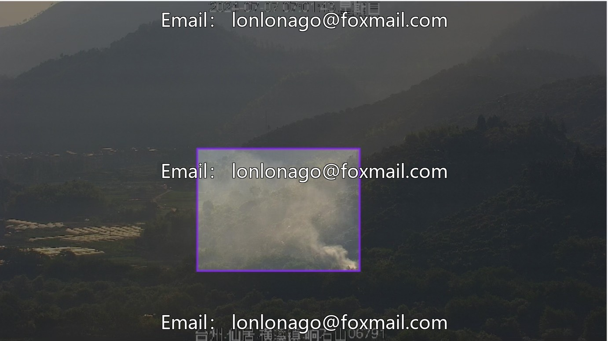
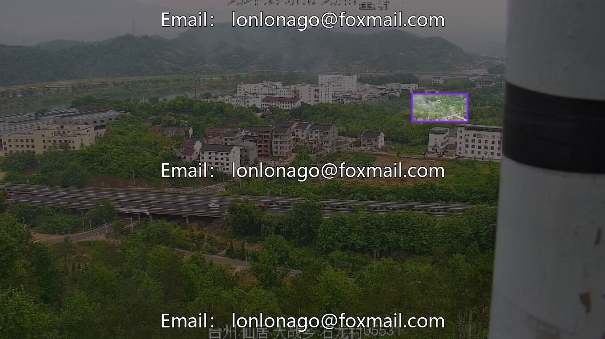
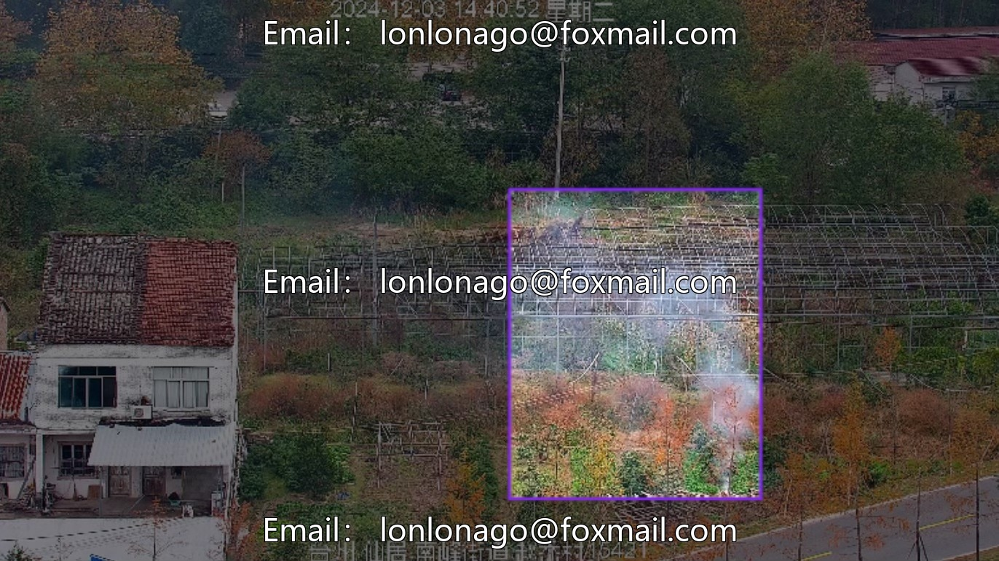
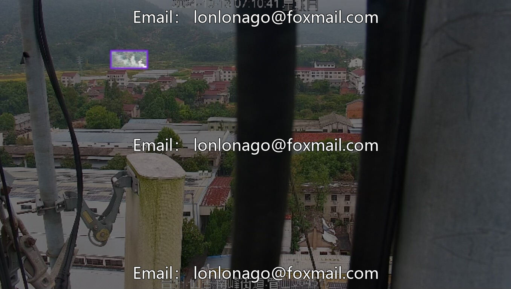
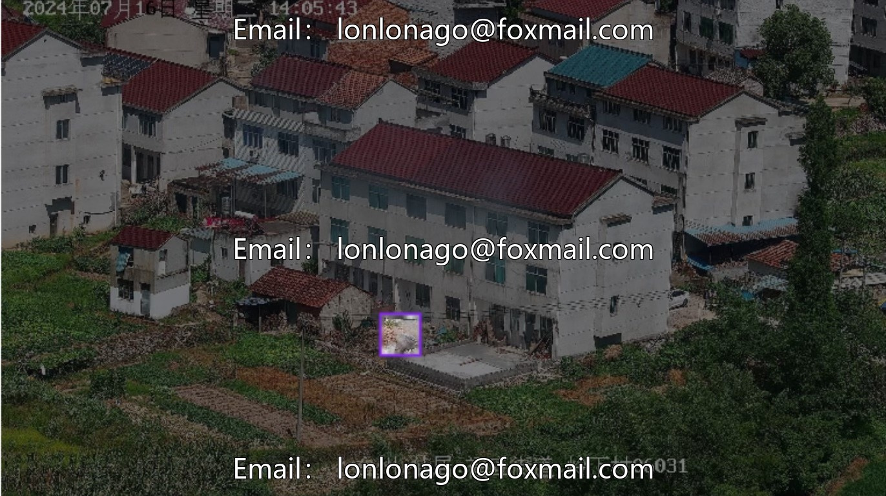
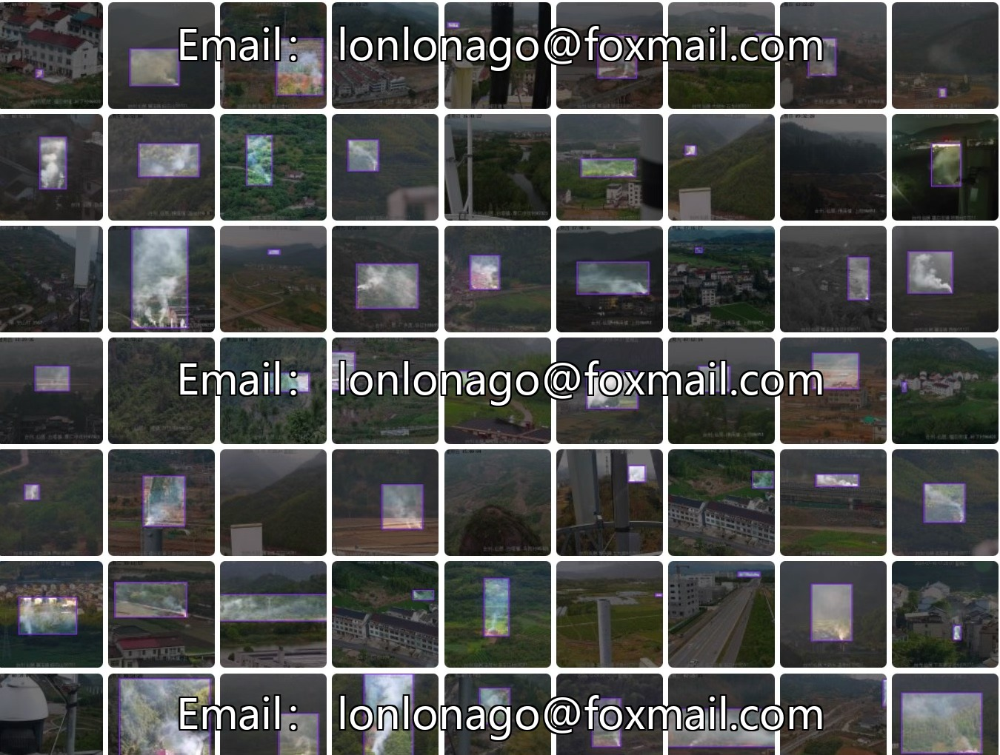
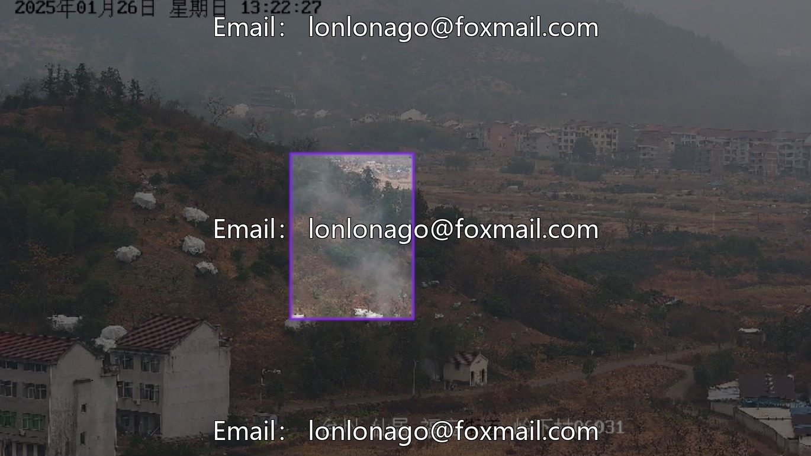
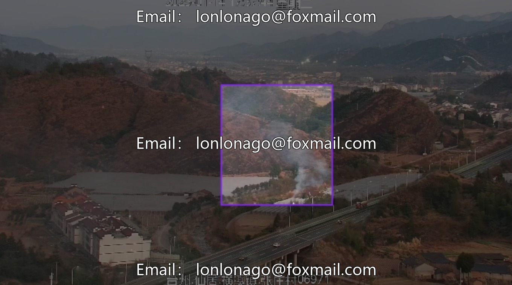

# Drone aerial photography inspection image dataset, forest fire smoke, field and rural smoke recognition

## Body

Drone aerial photography inspection image dataset, forest fire smoke and field and rural smoke recognition, forest fire prevention dataset, security monitoring and fire early warning image recognition 10358 period

The dataset contains 2767 smoke target detection images, with a single category, focusing on smoke (smoke), with precise annotations. It covers various smoke shapes and scenes, suitable for the development of smoke detection models, enhancing security monitoring, fire early warning, and algorithm optimization.

Image files support mainstream formats (JPG/PNG), annotation files are adapted for target detection tasks, and the scale is moderate, facilitating model training and validation.

Virtual materials, once sold, are non-refundable.
Interested friends, click "I want" to proceed.

## Images

## Payment

Here is a pay link on Stripe ( https://buy.stripe.com/3cs8yP7sY87d0vu9AB ). Please contact me lonlonago@foxmail.com after funding $89, and I will send you a complete data files , thank you!

